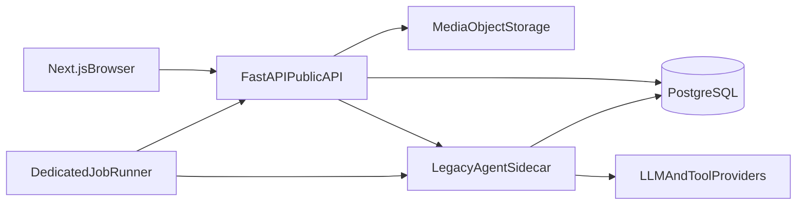

# Clinicle Intelligence Migration Plan

## Target architecture

- Keep the existing platform boundaries: Next.js in [`fe/`](fe/), FastAPI under [`be/app/v1/`](be/app/v1/), PostgreSQL schema `app`, and numbered SQL migrations in [`devops/db-migrations/`](devops/db-migrations/).
- Initially preserve the legacy agent runtime in [`clinicle-intelligence-old/agent/`](clinicle-intelligence-old/agent/) and [`clinicle-intelligence-old/bridge/agent_bridge.py`](clinicle-intelligence-old/bridge/agent_bridge.py) as a private sidecar. Do not expose its web.py console publicly.
- Make FastAPI the only public API and source of identity/authorization. It validates JWTs, derives `organization_id`, persists migrated domains, and invokes the sidecar with a short-lived internal service credential plus explicit organization/user context.
- Make Next.js the only browser UI. It communicates through `/api/v1/*`; it never calls the legacy service directly.
- Use PostgreSQL for relational/queryable data. Keep large source documents and generated artifacts in the platform’s media/object-storage abstraction, with metadata and tenant ownership in PostgreSQL.

## Phase 0: freeze, inventory, and contracts

- Treat [`clinicle-intelligence-old/`](clinicle-intelligence-old/) as a read-only behavioral baseline while migration is underway; remove or resolve its nested Git repository before normalizing it into the monorepo.
- Produce module BRD/SDD/API and data ownership documents in the repository-prescribed locations under [`devops/docs/system_docs/`](devops/docs/system_docs/), following [`devops/docs/rules/AI_RULES.md`](devops/docs/rules/AI_RULES.md).
- Inventory every legacy route in [`clinicle-intelligence-old/channel/web/web_channel.py`](clinicle-intelligence-old/channel/web/web_channel.py), every store referenced by [`clinicle-intelligence-old/common/state_dir.py`](clinicle-intelligence-old/common/state_dir.py), and every background process started by [`clinicle-intelligence-old/app.py`](clinicle-intelligence-old/app.py). Classify each as migrate, retain in sidecar, defer, or retire.
- Capture contract fixtures from representative legacy tenants before changing persistence: organizations/users, agents, sessions/messages/runs, knowledge documents, permissions, and streamed chat events.

## Phase 1: establish the sidecar boundary

- Add a minimal internal service entrypoint around the agent runtime; exclude legacy page rendering, signup/login, and public tenancy routes.
- Define versioned internal contracts for health, agent execution, cancellation, and streaming events. Use SSE initially because the legacy chat flow already streams; preserve event order, cancellation, and error semantics.
- Add service-to-service authentication, strict network isolation, request correlation IDs, timeouts, concurrency limits, and explicit `organization_id`, `user_id`, and `agent_id` on every call.
- Replace ambient tenant discovery at the boundary with an explicit `RuntimeIdentity`; reject calls with missing identity rather than falling back to global filesystem state.
- Move scheduler/channel processes out of the web request lifecycle. For the first release, run only the workers needed by agents, chat, and knowledge; defer meetings, workflows, and IM channels.

## Phase 2: design PostgreSQL ownership

- Create backend modules such as `be/app/v1/agents/`, `be/app/v1/conversations/`, and `be/app/v1/knowledge/`, following the repository’s `model.py`, `schema.py`, `services.py`, and `routes.py` pattern and registering routers in [`be/app/v1/router.py`](be/app/v1/router.py).
- Add numbered, idempotent migrations for tenant-scoped tables. At minimum: agent profiles/config versions; conversations; messages; agent runs/steps; knowledge collections/documents/chunks; sidecar execution records; and provider/tool references. Every tenant-owned row carries `organization_id`; add composite indexes and tenant-safe unique constraints.
- Reuse platform organizations, users, roles, JWTs, permission helpers, API envelopes, and media service rather than migrating legacy auth/session implementations from [`clinicle-intelligence-old/agent/tenancy/store.py`](clinicle-intelligence-old/agent/tenancy/store.py).
- Store secrets through a dedicated encrypted secret/provider configuration path; never copy keys into ordinary JSON columns, frontend variables, logs, or migration fixtures.
- Decide audit-chain preservation explicitly: import immutable legacy hashes/events and continue an append-only PostgreSQL audit chain, or archive the old chain as a verified artifact and begin a linked new chain.

## Phase 3: build repeatable data migration

- Implement idempotent ETL tooling that reads legacy SQLite/JSON/files through the existing store APIs, maps legacy org/user IDs to platform UUIDs, writes PostgreSQL in bounded transactions, and uploads document bodies/artifacts through the media abstraction.
- Support inventory, dry-run, migrate, verify, and rollback-by-batch modes. Record source path, legacy ID, target ID, checksum, migration version, status, and error for every migrated object.
- Migrate in dependency order: organizations/users mapping → agents → knowledge → conversations/messages → run metadata. Do not migrate credentials until their owner and encryption destination are established.
- Verify row counts, checksums, ownership, message ordering, knowledge retrieval samples, and cross-tenant isolation. Preserve the original stores unchanged until the acceptance window closes.

## Phase 4: expose the public FastAPI surface

- Implement `/api/v1/agents`, `/api/v1/conversations`, `/api/v1/chat`, and `/api/v1/knowledge` routes. Keep routers HTTP-only and all tenant filtering/business rules in services.
- Use PostgreSQL as the source of truth for migrated metadata. FastAPI invokes the sidecar only for execution/runtime functions; sidecar storage adapters read/write the new repositories instead of local SQLite/JSON for migrated domains.
- Add streaming and cancellation endpoints with disconnect handling, idempotency keys, persisted run states, bounded retries, and no automatic retry after an LLM/tool action may have executed.
- Add per-organization feature flags so tenants can be migrated and rolled back independently. Avoid long-lived dual writes; use a short shadow-read/compare period, then make PostgreSQL authoritative per tenant.

## Phase 5: build the first Next.js release

- Create authenticated App Router areas for agent selection/configuration, chat/session history, streaming run display/cancellation, and knowledge collection/document management.
- Add typed server actions/API clients using the existing [`fe/lib/actions/`](fe/lib/actions/) and [`fe/lib/utils/api-caller-helper.tsx`](fe/lib/utils/api-caller-helper.tsx) patterns. Extend [`fe/middleware.ts`](fe/middleware.ts) and route policy for permissions and organization routing.
- Port behavior and information architecture from the legacy views, not the old unbundled JavaScript implementation in [`clinicle-intelligence-old/channel/web/static/js/views/`](clinicle-intelligence-old/channel/web/static/js/views/). Rebuild with current React, Tailwind, and component conventions.
- Include loading/error/empty states, stream reconnection, accessible controls, localization readiness, and safe rendering of model/tool output.

## Phase 6: verify and cut over the first release

- Add backend unit/integration tests in [`test_unit_be/`](test_unit_be/), frontend tests in [`test_unit_fe/`](test_unit_fe/), API contract/tenant tests in [`test_st_api/`](test_st_api/), and critical Playwright journeys in [`test_st_ui/`](test_st_ui/).
- Required gates include JWT/permission failures, cross-tenant reads and writes, sidecar identity propagation, stream ordering/cancellation, migration idempotency, knowledge retrieval parity, and failure recovery.
- Run a pilot organization through migration, shadow comparisons, user acceptance, and rollback rehearsal. Then cut over tenant-by-tenant, monitor latency/error/token usage/job queues, and disable the corresponding legacy pages and stores.

## Later migration waves

- Wave 2: review queue and audit/governance.
- Wave 3: workflows, scheduler, webhooks, and task board using a dedicated worker model rather than FastAPI startup threads.
- Wave 4: meetings/transcripts and external connectors.
- Wave 5: IM channels, extensions/plugins, sovereignty/retention, and remaining administration.
- After parity and an agreed retention period, remove web.py, legacy auth, legacy UI assets, local tenant stores, and the old process manager. Retain only the extracted runtime packages/workers still needed.

## Delivery process

- Deliver one vertical slice at a time: schema/migration → backend service/API → sidecar adapter → Next.js UI → tests → pilot cutover.
- Keep each slice deployable behind a feature flag and document its data owner, rollback path, permission set, observability, and acceptance criteria before implementation.
- Do not begin with a whole-codebase rewrite. The first milestone is complete only when one pilot tenant can use agents, chat/sessions, and knowledge through Next.js with PostgreSQL-backed state and no browser dependency on port 9899.